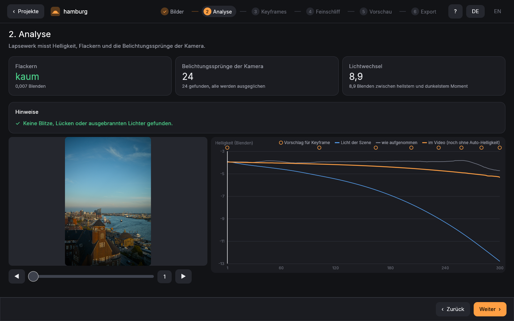

# Lapsewerk

A time-lapse workshop for macOS and Linux: keyframes, exposure ramps (day ↔ night), deflicker and astro tools, with
raw development by [LightCraft](https://github.com/storytold/lightcraft). Free, no subscription.
[Deutsch](README.md)

> Status: pre-release (0.1). Changes: [CHANGELOG.md](CHANGELOG.md) (German).



## Why Lapsewerk exists

For my time-lapses I used the well-known programs for a long time, and I was mostly happy with the results. What
bothered me was the forced subscription: paying every month just to develop my own photos. So I built the tool I
wanted. It costs nothing, needs no account and no subscription, and anyone can read and improve its code.
– Tim Kramarczyk

## Download

macOS (Apple Silicon, macOS 15 or later): the signed and notarized `Lapsewerk-<version>.dmg` on the
[Releases](https://github.com/t-kramarczyk/lapsewerk/releases) page. Open it and drag Lapsewerk to Applications.
Linux: build it yourself (below).

| | macOS | Linux |
|---|---|---|
| App, analysis, keyframes, preview, test video as frames | ✔ | ✔ |
| Export as a frame sequence (16-bit TIFF, 10-bit DPX, OpenEXR), HDR too | ✔ | ✔ |
| Export as a movie (`.mov`: ProRes, HEVC) | ✔ (AVFoundation) | – (export frames, make the movie in your editor or with ffmpeg) |

## What it does

The app leads through six steps, in German or English:

1. **Photos**: reads a folder of raws: interval, gaps, damaged files and the exposure steps you made at the camera.
2. **Analysis**: measures every frame's brightness; flags flashes, clipped highlights and odd frames.
3. **Keyframes**: suggestions, edited in the app or in LightCraft; XMP sidecars from other raw editors (`crs:`
   values: look, crop, straightening, masks) are read and blend from keyframe to keyframe.
4. **Polish**: deflicker in two passes (the second measures the finished frames), how much of the real change of
   light stays from day to night, a hand-drawn brightness curve, stabilizing, camera moves, dust, denoise, astro
   (dim stars, take out light pollution, star trails).
5. **Preview**: play, before/after, a quick test video.
6. **Export**: ProRes 422 HQ / 4444, HEVC, TIFF, DPX, OpenEXR, HDR (PQ, HLG), timecode with drop frame; resumable,
   with checksums and an `INFO.txt` for the edit.

Your originals are never changed, and nothing is exported into the photo folder.

## Command line

```sh
lapsewerk import ~/Pictures/Sequence          # frames, interval, gaps, exposure steps
lapsewerk analyze ~/Pictures/Sequence --csv analysis.csv
lapsewerk render ~/Pictures/Sequence --out film.mov --codec hevc --verify
lapsewerk render ~/Pictures/Sequence --from-project   # exactly as set in the app
lapsewerk --help                              # every option
```

All brightness values are in stops (log2); corrections add up: exposure = keyframe course + ramp correction +
deflicker.

## Building

Rust 1.95 or later; on macOS the Xcode command line tools (the movie encoder is a small Swift helper).

```sh
scripts/build-release.sh                      # target/release/lapsewerk and lapsewerk-app, without build paths
packaging/macos/build-app.sh                  # macOS: Lapsewerk.app and a .dmg (ad-hoc signed)
cargo test --workspace
```

LightCraft comes from [t-kramarczyk/lightcraft-lapsewerk](https://github.com/t-kramarczyk/lightcraft-lapsewerk):
the upstream snapshot plus the patches Lapsewerk needs (see its `LAPSEWERK.md` and [docs/lightcraft.md](docs/lightcraft.md)).

## Legal

Lapsewerk is an independent work. It contains no code, interfaces, texts, presets or names of other time-lapse,
deflicker or astro programs; its methods follow published literature (e.g. LOWESS, Fritsch–Carlson).

## Support

Lapsewerk is free. If it was worth a film to you: [buy me a coffee](https://paypal.me/TimKramarczyk).
Bugs and ideas: [Issues](https://github.com/t-kramarczyk/lapsewerk/issues). Please add the `delivery:` line the
command line prints, or what the app showed.

## Licence

GPL-3.0-or-later, see [LICENSE](LICENSE). Third-party components: [NOTICE](NOTICE) and
[THIRD-PARTY-LICENSES.txt](THIRD-PARTY-LICENSES.txt).
