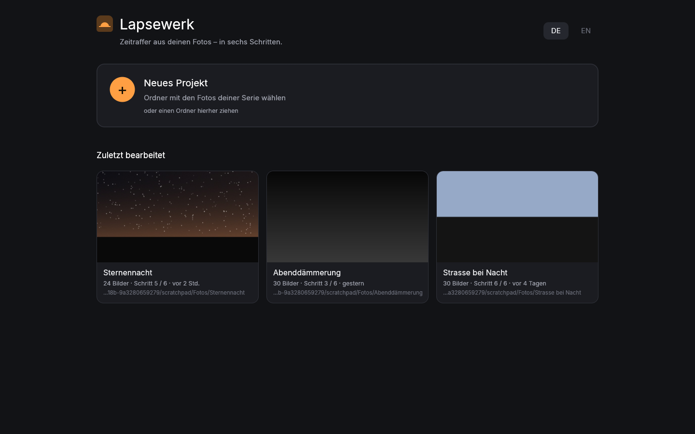
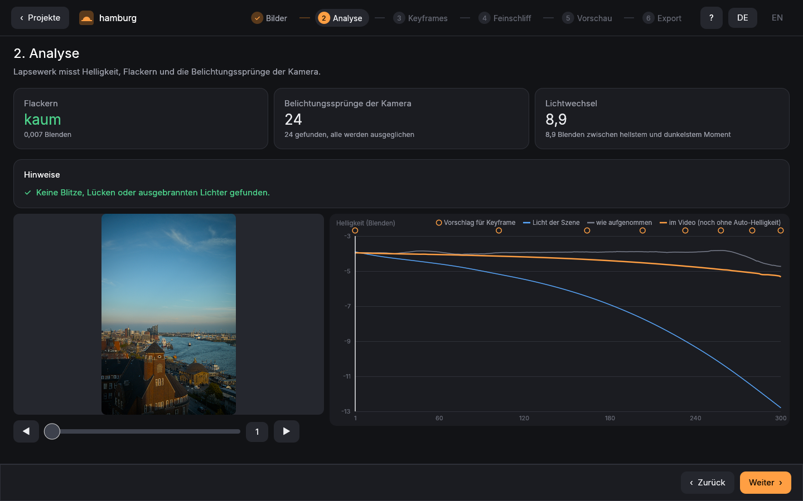

# Lapsewerk

Zeitraffer-Werkstatt für macOS und Linux: Keyframes, Belichtungsrampen (Tag ↔ Nacht), Deflicker und
Astro-Werkzeuge, mit der RAW-Entwicklung von [LightCraft](https://github.com/storytold/lightcraft), ohne Abo.
[English](README.en.md)

> Status: Vorabversion (0.1). Änderungen: [CHANGELOG.md](CHANGELOG.md).

## Warum es Lapsewerk gibt

Für meine Zeitraffer habe ich lange die bekannten Programme benutzt. Mit den Ergebnissen war ich grundsätzlich
zufrieden. Gestört hat mich etwas anderes: der Abo-Zwang. Jeden Monat zahlen, nur um die eigenen Fotos entwickeln zu
können. Also habe ich mir das Werkzeug gebaut, das ich mir gewünscht habe. Es kostet nichts, braucht kein Konto und
kein Abo, und den Quellcode kann jeder ansehen und weiterentwickeln. – Tim Kramarczyk

## Download

macOS (Apple Silicon, ab macOS 15): das signierte und notarisierte `Lapsewerk-<Version>.dmg` unter
[Releases](https://github.com/t-kramarczyk/lapsewerk/releases). Öffnen und Lapsewerk in „Programme“ ziehen.
Linux: selbst bauen (unten).

**Was wo geht:**

| | macOS | Linux |
|---|---|---|
| App, Analyse, Keyframes, Vorschau, Probevideo als Bilder | ✔ | ✔ |
| Export als Bildfolge (16-Bit-TIFF, 10-Bit-DPX, OpenEXR), auch HDR | ✔ | ✔ |
| Export als Videodatei (`.mov`: ProRes, HEVC) | ✔ (AVFoundation) | – (Bildfolge exportieren und z. B. in DaVinci Resolve oder mit ffmpeg zum Video machen) |

Die Beispiele unten mit `--out film.mov` laufen nur auf dem Mac; unter Linux `--sequence --out ORDNER` verwenden.

Anleitung mit Rezepten (Sonnenaufgang, Nacht, Sternspuren, HDR): [`docs/anleitung.md`](docs/anleitung.md).

## App

`cargo run --release -p lapsewerk-app` öffnet die Oberfläche: Projektverwaltung mit den letzten Projekten, dann sechs
nummerierte Schritte (Bilder → Analyse → Keyframes → Feinschliff → Vorschau → Export) mit Helligkeitskurve, Vorschau
(abspielen, vorher/nachher, Bild für Bild) und Fortschritt mit Restzeit bei allem, was dauert. Deutsch und Englisch.
Dazu: Warnungen vor Blitzen, ausgebrannten Lichtern und Lücken (mit Reparatur), Kamerafahrt (Zoom, Schwenk),
alle Regler und Masken (Verlauf, Radial, Himmel, Helligkeit) in den Keyframes, Übertragen zwischen Keyframes,
„In LightCraft öffnen“, Rückgängig, Filmstreifen und ein schnelles Probevideo.




## Ablauf

1. **Bilder** – Sequenz einlesen, Intervall, Lücken, kaputte Fotos und Belichtungssprünge erkennen.
2. **Analyse** – Helligkeit messen (gespeichert neben den Fotos), Blitze, ausgebrannte Lichter, Lücken.
3. **Keyframes** – Vorschläge, dann in der App oder in LightCraft bearbeiten (XMP `lc:settings`); nie bearbeitete
   folgen den bearbeiteten (Auto-Übergang).
4. **Feinschliff** – Deflicker (zwei Durchgänge, selbstprüfend), Tag ↔ Nacht, Handkurve, Stabilisieren, Astro.
5. **Vorschau** – abspielen, vorher/nachher, Probevideo.
6. **Export** – Video (Mac: ProRes/HEVC) oder Bildfolge (TIFF/DPX/EXR, überall), fortsetzbar, mit `INFO.txt`.

Originale werden nie verändert, und in den Fotoordner wird nie exportiert.

## Aufbau

| Crate | Aufgabe |
|---|---|
| `lapsewerk-core` | Sequenz, Belichtung, Keyframe-Interpolation, Deflicker – ohne Abhängigkeiten |
| `lapsewerk-develop` | Brücke zu LightCraft: Sequenz öffnen, Keyframes aus XMP, Renderaufträge |
| `lapsewerk-video` | Videodatei über AVFoundation (ProRes, HEVC); Hilfsprogramm `encoder.swift` |
| `lapsewerk-studio` | der ganze Ablauf als Bibliothek (Analyse, Korrekturen, Export, Cache), für App und CLI |
| `lapsewerk-cli` | Kommandozeile `lapsewerk import` / `analyze` / `render` / `calibrate` |
| `lapsewerk-app` | die Oberfläche (egui) |

## Benutzen (Kommandozeile)

```sh
cargo build --release
# Import: Bilder, Intervall, Lücken, Belichtungssprünge → lapsewerk.json im Ordner
target/release/lapsewerk import ~/Bilder/Sequenz
# Analyse: Intervall, Belichtungsschritte (gegen Rohdaten geprüft), Flackern, CSV
target/release/lapsewerk analyze ~/Bilder/Sequenz --csv analyse.csv
# Keyframes anlegen: XMP-Sidecars an den vorgeschlagenen Bildern (nur wo noch keins liegt), dann in LightCraft bearbeiten
target/release/lapsewerk analyze ~/Bilder/Sequenz --write-keyframes
# Video: Keyframes aus XMP interpoliert, Rampe + Deflicker (zwei Durchgänge), 4K ProRes 422 HQ
target/release/lapsewerk render ~/Bilder/Sequenz --out film.mov
# Hochkant-Sequenz: das Video wird automatisch hochkant; Ausschnitt verschieben mit --position X,Y
# Wo die Renderzeit hinfließt
target/release/lapsewerk bench ~/Bilder/Sequenz
# kleiner zum Teilen, mit Nachmessung des Restflackerns
target/release/lapsewerk render ~/Bilder/Sequenz --out film.mov --codec hevc --verify
```

Bildpflege beim Rendern (jeweils einzeln zuschaltbar):

| Option | Wirkung |
|---|---|
| `--dust` | Sensorstaub entfernen (weiche dunkle Flecken an fester Stelle, auf glattem Grund wie Himmel) |
| `--denoise R` | zeitliches Entrauschen über R Bilder je Seite |
| `--blend N` | Bewegungsunschärfe aus N Bildern |
| `--stabilize` | Verwacklung ausgleichen |
| `--keep-light F` | Tag ↔ Nacht: Anteil F des echten Lichtwechsels behalten (App: 0,15) |
| `--auto-brightness` | zu dunkel gezeigte Serie einmal anheben (Tag, Nacht mit dunklem Himmel) |
| `--base-look` | Grund-Look für Serien ohne bearbeitete Keyframes |
| `--reference X,Y,B,H` | Deflicker misst nur in diesem Bildteil (Anteile 0–1, z. B. `0,0,1,0.4` = obere 40 %): Himmel ohne Scheinwerfer, Menschen, Wasser darunter |
| `--regional CxR` | regionaler Deflicker (experimentell) |
| `--transfer rec709` | Sendemaster (BT.1886) |
| `--light-pollution F` | Nachthimmel: Anteil F (0–1) der Lichtverschmutzung entfernen (glatte Fläche je Bild, über 13 Bilder gemittelt); `--sky X,Y,B,H` = Himmelsbereich des Videobilds (Standard obere 60 %) |
| `--reduce-stars F` | Sterne um Anteil F (0–1) abdunkeln (0,5 beruhigt einen vollen Himmel) |
| `--star-trails N` | Sternspuren, über N Bilder ausblendend (0: endlos); mit `--sky` nur im Himmel (Vordergrund ohne Spuren) |
| `--hdr pq\|hlg` | HDR-Video (Rec. 2020, LightCraft-HDR-Spielraum, SDR-Weiß 203 cd/m²); `--hdr-peak EV` Spielraum über SDR-Weiß (PQ: 3, höchstens 5; HLG: 2,3) |

Hotpixel werden immer in den Rohdaten repariert (`--keep-hot-pixels` schaltet ab).

Keyframes sind die Bilder mit XMP-Sidecar (in LightCraft bearbeitet). Ein vorhandenes Video wird nur mit
`--overwrite` ersetzt, und erst, wenn das neue vollständig ist.

Alle Helligkeiten sind in Blendenstufen (log2), Korrekturen addieren sich:
Belichtung = Keyframe-Verlauf + Rampenausgleich + Deflicker.

## Unter Linux installieren

```sh
scripts/build-release.sh         # braucht Rust ≥ 1.95; die Programme liegen in target/release
install -Dm755 target/release/lapsewerk-app ~/.local/bin/lapsewerk-app
install -Dm755 target/release/lapsewerk ~/.local/bin/lapsewerk
install -Dm644 packaging/lapsewerk.desktop ~/.local/share/applications/lapsewerk.desktop
install -Dm644 packaging/lapsewerk.svg ~/.local/share/icons/hicolor/scalable/apps/lapsewerk.svg
install -Dm644 packaging/lapsewerk.png ~/.local/share/icons/hicolor/256x256/apps/lapsewerk.png
install -Dm644 -t ~/.local/share/doc/lapsewerk LICENSE NOTICE THIRD-PARTY-LICENSES.txt   # gehören dazu
```

`scripts/build-release.sh` baut wie `cargo build --release`, nur ohne die Pfade des Bausystems in den Programmen
(Benutzerordner, Checkout, Cargo und rustup). Die Programme laufen auf dem System, auf dem sie gebaut wurden, und
neueren (glibc). Für ältere Systeme auf dem
ältesten gewünschten System bauen (z. B. Ubuntu 22.04) oder mit `cargo zigbuild --target x86_64-unknown-linux-gnu.2.35`.

## Mac-App bauen

```sh
packaging/macos/build-app.sh     # Lapsewerk.app und .dmg in target/macos (ad-hoc signiert, nur für diesen Mac)
SIGN_ID="Developer ID Application: …" NOTARY_KEY_ID=… NOTARY_ISSUER=… NOTARY_KEY_FILE=….p8 \
  packaging/macos/build-app.sh   # signiert, notarisiert und geheftet, zum Weitergeben
```

## Entwickeln

```sh
cargo test
cargo clippy --all-targets -- -D warnings
cargo fmt --check
```

## Rechtliches

Lapsewerk ist eine eigenständige Neuentwicklung. Es enthält keinen Code, keine Oberflächen, Texte, Presets oder
Namen anderer Zeitraffer-, Deflicker- oder Astro-Programme; die Verfahren folgen veröffentlichter Fachliteratur
(z. B. LOWESS, Fritsch–Carlson). Genannte Produktnamen gehören ihren Inhabern.

## Unterstützen

Lapsewerk ist kostenlos. Wenn es dir einen Film wert war: [Spendier mir einen Kaffee](https://paypal.me/TimKramarczyk).

## Lizenz

GPL-3.0-or-later, siehe [LICENSE](LICENSE). Drittkomponenten: [NOTICE](NOTICE); alle Crates mit ihren
Lizenztexten (auch der Schriften) in [THIRD-PARTY-LICENSES.txt](THIRD-PARTY-LICENSES.txt), erzeugt mit
`python3 scripts/third_party_licenses.py` (nach jeder Änderung an `Cargo.lock` neu erzeugen).
