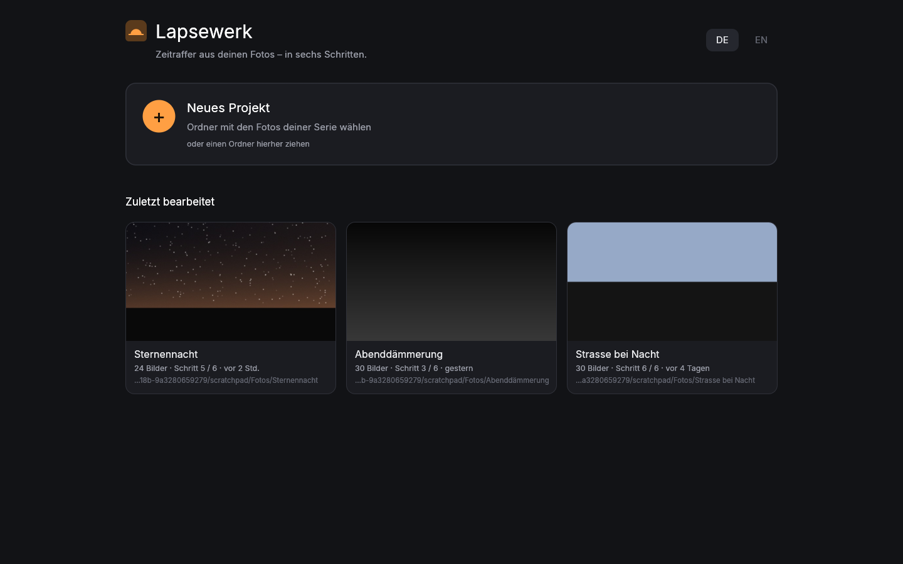
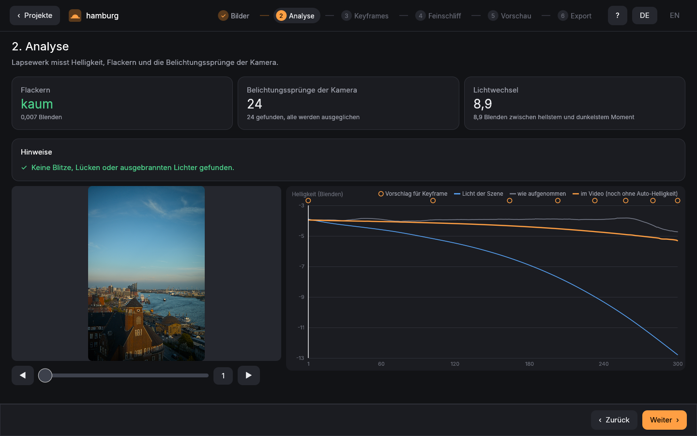
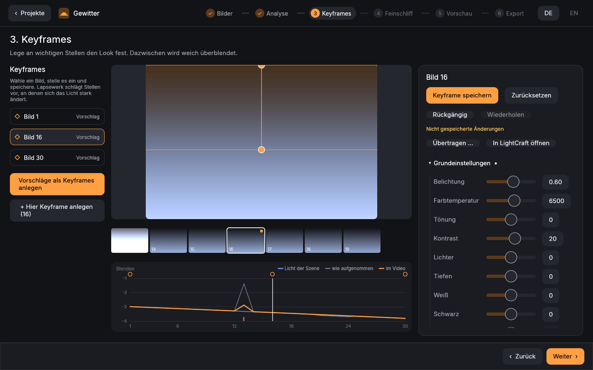
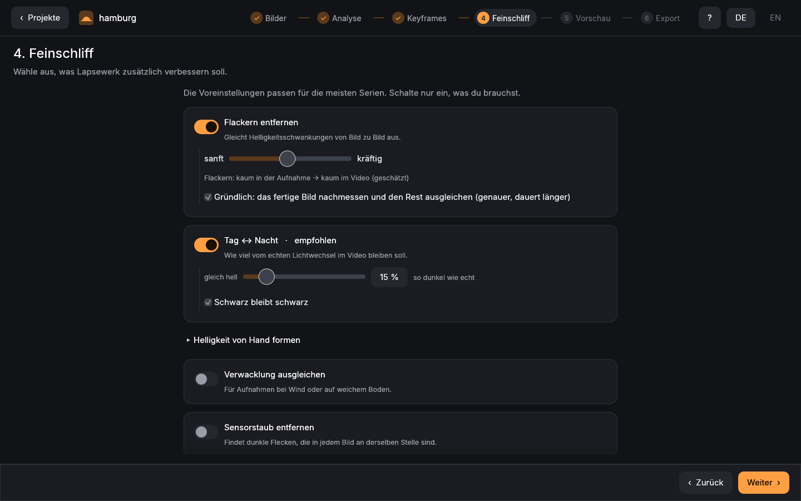
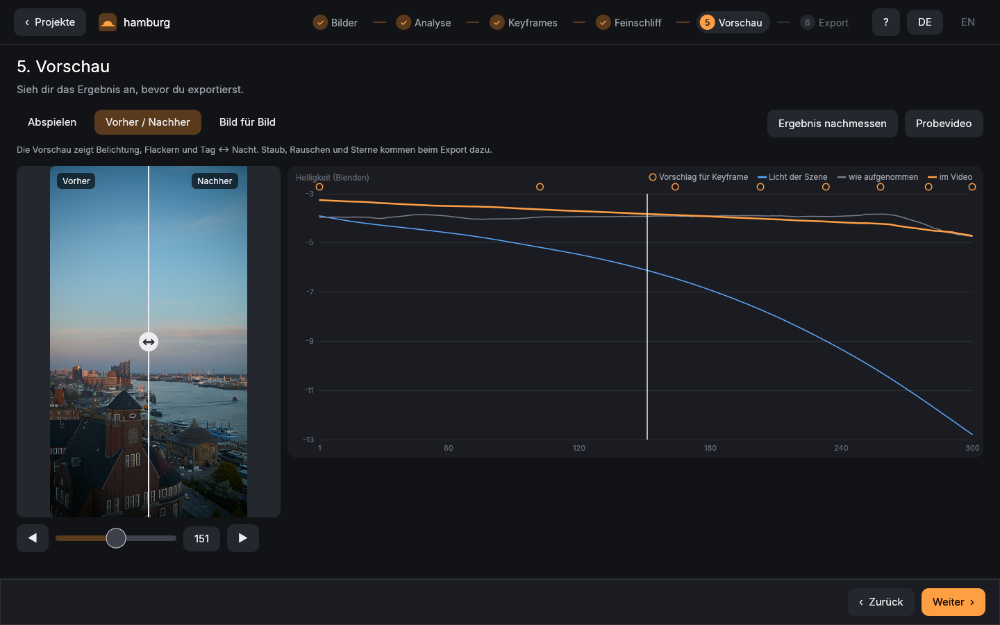
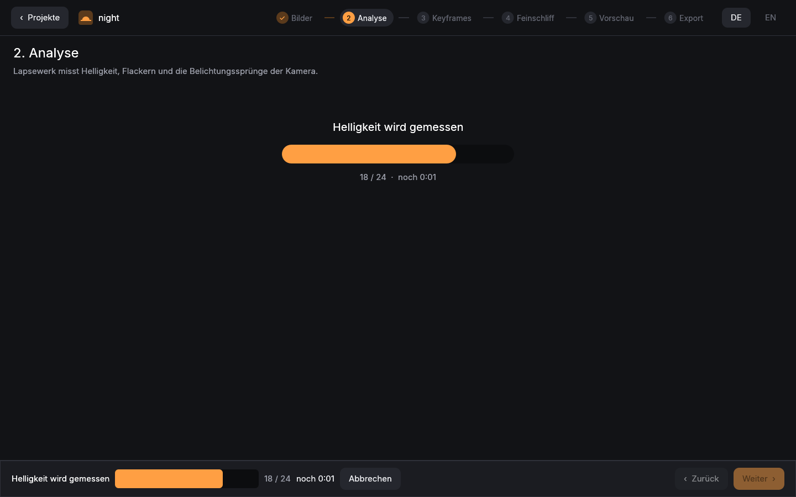

# Lapsewerk – Anleitung

Lapsewerk macht aus einer Fotoserie ein Zeitraffer-Video. Die Bilder werden mit LightCraft entwickelt.
Belichtungssprünge der Kamera werden ausgeglichen, Flackern wird entfernt, und am Ende entsteht direkt ein
ProRes- oder HEVC-Film (am Mac) oder eine Bildfolge (16-Bit-TIFF, DPX oder OpenEXR, auf jedem System). Die Originale
werden nie verändert, und Exporte kommen nie zwischen die Fotos, sondern in einen eigenen Ordner (Standard:
`Lapsewerk-Export` im Fotoordner). Neben die Fotos legt Lapsewerk nur seine Projektdatei (`lapsewerk.json`), die
gespeicherte Messung (`.lapsewerk-analysis.json`, `.lapsewerk-corrections.json`) und die XMP-Dateien der Keyframes.

> **Linux:** Videodateien (`.mov`) entstehen nur am Mac. Unter Linux exportiert Lapsewerk eine Bildfolge, die du in
> DaVinci Resolve, Premiere oder mit ffmpeg zum Video machst, z. B.
> `ffmpeg -framerate 25 -i Ordner/Ordner_%06d.tif -c:v libx264 -pix_fmt yuv420p -crf 16 film.mp4`.
> In den Rezepten unten steht dann statt `--out film.mov` einfach `--sequence --out ORDNER`.

## Mit der App (empfohlen)

`cargo run --release -p lapsewerk-app` (oder das gebaute `target/release/lapsewerk-app`) öffnet Lapsewerk mit Oberfläche:
Beim ersten Start erklärt eine kurze Einführung (vier Seiten) das Wichtigste; später holt sie „Einführung ansehen“
zurück. In jedem Schritt öffnet das **?** oben (oder **F1**) eine Hilfe zu diesem Schritt mit Tipps für die Aufnahme.

Auf der **Startseite** wählst du den Ordner mit der Fotoserie (oder ziehst ihn ins Fenster); die letzten Projekte
öffnen sich mit einem Klick. Dann führen sechs Schritte durch das Projekt:

1. **Bilder:** wie viele Bilder es sind, das Intervall und ob Bilder fehlen oder kaputt sind (sie werden weggelassen
   und ihre Stelle später gefüllt) → *Analyse starten*.
2. **Analyse:** Flackern, Belichtungssprünge und Lichtwechsel in Worten, dazu die Helligkeitskurve. Klicken oder
   ziehen in der Kurve zeigt das Bild an dieser Stelle.
   Darunter stehen **Hinweise**: auffällige Einzelbilder (Blitz, Scheinwerfer, jemand vor der Linse) werden durch ihre
   Nachbarn ersetzt, Lücken in der Aufnahme mit Zwischenbildern gefüllt, ausgebrannte Lichter und gemischte
   Hoch-/Querformate werden gemeldet. Die Bildnummern springen zur Stelle. In der Vorschau (*Bild für Bild*) lässt
   sich jedes Bild auch von Hand ersetzen. Die Analyse wird neben den Fotos gespeichert: beim Wiederöffnen wird
   nicht neu gemessen, solange Fotos und Keyframes gleich bleiben.
3. **Keyframes:** *Vorschläge als Keyframes anlegen*, ein Bild wählen, mit den Reglern einstellen und *Keyframe
   speichern*. Es gilt der **Auto-Übergang**: angelegte, aber nie bearbeitete Keyframes stehen in der
   Liste als *automatisch* und folgen den bearbeiteten (sie werden aus ihnen überblendet und gespeichert, entlang
   des Lichts der Szene: ein Keyframe in der blauen Stunde bekommt so viel vom Nacht-Look, wie das Licht dort schon
   gefallen ist, nicht so viel, wie seine Bildnummer sagt). Typisch:
   nur den ersten (Tag) und letzten (Nacht) Keyframe einstellen, die übrigen gehen weich mit. Folgen können nur
   Keyframes *zwischen* bearbeiteten; einer davor oder danach behält seinen Look (wird nur die Nacht bearbeitet,
   bleibt der Tag, wie er ist). Wird ein automatischer Keyframe bearbeitet – hier, in LightCraft oder von Hand –, gilt er als bearbeitet und wird nie
   überschrieben (Sterne/Bewertungen in der XMP zählen nicht als Bearbeitung). *Wieder automatisch* macht einen
   bearbeiteten Keyframe zwischen anderen wieder zum folgenden. Welche Keyframes automatisch sind, steht in
   `lapsewerk.json` und als Markierung `lapsewerk:Automatic` in ihrer eigenen XMP: wer nur Fotos und XMP weitergibt,
   behält sie.
   Der Filmstreifen unter dem Bild zeigt die Nachbarbilder (Keyframes mit Punkt); *Rückgängig* / *Wiederholen*
   (Cmd/Strg+Z, Umschalt+Cmd+Z oder Strg+Y) gehen Regler-Änderungen zurück und vor.
   Über den Reglern: ein Histogramm (Punkte zeigen abgeschnittene Lichter oder Tiefen), *Auto* (wie die Auto-Taste gängiger Raw-Programme),
   *Weißabgleich: Auto* und die *Pipette*: anklicken, dann ins Bild auf etwas Graues oder Weißes klicken.
   Alle Regler stehen in den üblichen Gruppen (Grundeinstellungen, Präsenz, Gradationskurve, Farbmischer,
   Color Grading, Details, Objektiv, Vignette und Körnung, Kalibrierung); ein Punkt zeigt, wo etwas eingestellt ist,
   Doppelklick setzt einen Regler zurück. *Übertragen …* kopiert angehakte Gruppen (Belichtung
   und Weißabgleich sind zuerst aus) auf angehakte Keyframes und speichert sie.
   **Masken** wirken nur auf einen Teil des Bildes: *Verlauf* (Anfang und Ende im Bild ziehen, auch schräg),
   *Radial* (Mitte und Ränder ziehen), *Himmel* (in jedem Bild neu erkannt), *Helligkeit* (nur helle oder dunkle
   Teile) und *Pinsel* (im Bild malen oder radieren, mit Größe und weicher Kante; jeder Strich lässt sich
   rückgängig machen). Jede Maske hat eigene Regler und lässt sich umkehren. Zwischen Keyframes blenden Masken weich über, auch
   ihre Lage; ein Keyframe ohne die Maske lässt sie aus- oder einblenden. Zugeordnet wird nach dem Namen der Maske.
   Für alles, was die App nicht selbst kann (Kurvenpunkte, Objektivprofile), öffnet *In LightCraft öffnen*
   den Keyframe dort. Speichere in LightCraft die Metadaten in die Datei (oder schalte das automatische XMP-Schreiben
   ein): Lapsewerk bemerkt das und übernimmt die Änderungen von selbst. Ein anderes LightCraft-Programm wählst du mit
   der Umgebungsvariablen `LAPSEWERK_LIGHTCRAFT`. Ist eine XMP-Datei beschädigt, steht das über der Liste.
4. **Feinschliff:** Schalter für Flackern (mit Stärke von sanft bis kräftig), Tag ↔ Nacht (bei Sonnenauf-/-untergang schon an), Verwacklung, Staub,
   Bewegung, Rauschen, Nachthimmel. Technisches steckt unter *Erweitert*. **Helligkeit von Hand formen**: in die
   Kurve klicken setzt einen Punkt (neben einer Keyframe-Raute rastet er dort ein), ziehen macht dort heller oder
   dunkler, Doppelklick entfernt ihn; die gestrichelte Linie zeigt das Bild für *+ Punkt*.
   Unter **Bildausschnitt und Kamerafahrt** wählst du, welcher Teil des Bildes ins Video kommt, und ob die Kamera
   langsam heranzoomt, wegzoomt oder schwenkt. Das kleine Bild zeigt den Ausschnitt am Anfang (weiß) und am Ende.
5. **Vorschau:** abspielen, vorher/nachher mit Schieber, Bild für Bild (Pfeiltasten, Leertaste spielt ab).
   **Probevideo** rechnet schnell eine kleine Fassung (960 × 540) mit allen Einstellungen, auch Staub, Rauschen,
   Sternen und Kamerafahrt, und legt sie in `Lapsewerk-Export` („… – Probe“: am Mac ein Video, sonst Bilder).
   **Ergebnis nachmessen** misst den fertigen Look einmal nach (wie `--verify`): Restflackern von Bild zu Bild
   (sichtbar ab etwa 0,01 Blenden) und, wenn eine Stelle heraussticht, den unruhigsten Abschnitt, dazu langsame Wellen
   oder Knicke über 10–20 Bilder (ab 0,03 Blenden). Ersetzte Blitzbilder
   und gefüllte Lücken zählen nicht mit. Es dauert etwa doppelt so lange wie der Ausgleich.
6. **Export:** Format wählen (4K, Full HD, Hochkant; am Mac als Video, sonst als Bildfolge) → *Video erstellen* bzw.
   *Bilder erstellen*. Unter *Erweitert*: Größe bis 8K und DCI 4K, Codec (ProRes 422 / 422 HQ / 4444, HEVC),
   Bildfolge als TIFF, DPX oder OpenEXR, NTSC-Bildraten (23,976 / 29,97 / 59,94), Timecode (mit `;` als
   Drop-Frame bei 29,97/59,94), Rec. 709, HDR als PQ (HDR10) oder HLG. Unter „Speichern als“ steht, was im Zielordner schon liegt: eine
   fertige Folge mit denselben Einstellungen, ein abgebrochener Export (dann ist *Fortsetzen* der Hauptknopf und
   rechnet nur den Rest) oder Bilder mit anderen Einstellungen (sie werden ersetzt). *In die Warteschlange* rechnet
   im Hintergrund weiter, auch mehrere Projekte nacheinander. Hat sich seit der Vorschau nichts geändert, übernimmt
   der Export ihre Korrekturen und fängt gleich mit dem Rendern an. Neben einer Bildfolge liegt `INFO.txt` mit allen
   Lieferangaben, den Reparaturen und dem Befehl, der genau diese Folge noch einmal erzeugt.

**Kamera einmessen** (Startseite, einmal je Kamera): Wähle einen oder mehrere Ordner mit vielen deiner RAW-Fotos,
möglichst verschiedene Motive und Farben, mit eingebettetem Kamera-JPEG (Sony, Nikon und Fujifilm speichern es immer
mit). Lapsewerk vergleicht die Rohdaten mit dem JPEG der Kamera und berechnet daraus ein Farbprofil für dein Modell,
z. B. für die A6700, für die LightCraft keins mitbringt; die A7 IV hat eins, ein eigenes aus deinen Fotos ersetzt es.
Das Profil gilt nach einem Neustart in Lapsewerk und LightCraft. Kommandozeile: `lapsewerk calibrate ORDNER …`.

Wo es dauert, steht unten, was gerade passiert, wie weit es ist und wie lange es noch dauert; *Abbrechen* geht immer.
Die Einstellungen eines Projekts liegen in `lapsewerk.json` bei den Fotos.

| | |
|---|---|
|  |  |
|  |  |
|  |  |

## Mit der Kommandozeile

Alle Befehle laufen im Terminal. `lapsewerk` steht für `target/release/lapsewerk` nach `cargo build --release`.

## Der Ablauf mit der Kommandozeile

1. **Bilder in einen Ordner legen.** Eine Serie gehört in einen Ordner. Hat die Kamera RAW+JPEG aufgenommen, ist das
   kein Problem: Lapsewerk nimmt automatisch die Raw-Dateien. Versteckte `._`-Dateien von SD-Karten werden übersprungen.
2. **Importieren:**
   ```sh
   lapsewerk import ~/Bilder/Sonnenaufgang
   ```
   Lapsewerk liest Aufnahmezeiten und Belichtung und schreibt `lapsewerk.json` in den Ordner. Danach zeigt es das
   Intervall, Lücken (z. B. Kartenwechsel) und die Belichtungssprünge der Kamera.
3. **Analysieren und Keyframes anlegen:**
   ```sh
   lapsewerk analyze ~/Bilder/Sonnenaufgang --write-keyframes
   ```
   Lapsewerk misst Helligkeit und Flackern und schlägt Keyframes vor: Bilder, an denen sich das Licht so weit
   geändert hat, dass du dort nachbearbeiten solltest. Mit `--write-keyframes` bekommt jedes vorgeschlagene Bild ein
   XMP-Sidecar mit den Einstellungen, die das Video dort gerade hätte. Schon vorhandene Sidecars werden nie geändert.
   Die neuen Keyframes sind *automatisch* (Auto-Übergang, wie in der App): bearbeitest du danach nur einige – etwa
   den ersten und den letzten –, folgen die übrigen bei jedem `analyze` und `render` von selbst
   („auto transition: keyframe(s) … follow the edited ones“). Einen einmal bearbeiteten überschreibt Lapsewerk nie.
4. **Keyframes in LightCraft bearbeiten.** Öffne die Bilder mit Sidecar in LightCraft und stelle Belichtung,
   Weißabgleich, Kontrast usw. ein. Zwischen den Keyframes überblendet Lapsewerk die Einstellungen weich, auch die
   Masken (Verläufe, radiale Filter: ihre Regler und ihre Lage; Masken werden nach ihrem Namen zugeordnet).
5. **Rendern:**
   ```sh
   lapsewerk render ~/Bilder/Sonnenaufgang --out sonnenaufgang.mov --verify
   ```
   Das ergibt ein 4K-Video in ProRes 422 HQ mit 25 Bildern/s. `--verify` misst am Ende nach, wie viel Flackern
   übrig ist, und nennt ab 0,03 Blenden auch langsame Wellen oder Knicke über 10–20 Bilder, die das Flackern von Bild
   zu Bild kaum zählt (eine pumpende Rampe, ein vorgezogener Mondaufgang).

**Genau wie in der App, aber von der Kommandozeile** (z. B. über Nacht oder auf einem anderen Rechner):
```sh
lapsewerk render ~/Bilder/Sonnenaufgang --from-project
```
nimmt alle Einstellungen, die die App für den Ordner gespeichert hat (Feinschliff, Kamerafahrt, Format, Ziel). Weitere
Optionen dahinter gelten zusätzlich, z. B. `--movie` für eine Videodatei statt der Bildfolge. Die App zeigt den Befehl
unter Export → *Erweitert* zum Kopieren.

Ein Video, das es schon gibt, wird nur mit `--overwrite` ersetzt, und erst, wenn das neue fertig ist. Mit
**Ctrl-C** kannst du jederzeit abbrechen. Die halbfertige Datei wird dann gelöscht.

## Typische Rezepte

**Sonnenaufgang oder -untergang (Tag ↔ Nacht).** Die Kamera hat nachgeregelt, das Video soll aber noch zeigen,
dass es heller oder dunkler wird:
```sh
lapsewerk render ORDNER --out film.mov --keep-light 0.15 --auto-brightness --base-look --verify
```
`--keep-light 0.15` behält 15 % des echten Lichtwechsels (die Vorgabe der App). 0 heißt durchgehend gleich hell, 1 heißt
die Nacht so dunkel, wie sie war. `--auto-brightness` hebt eine zu dunkel gezeigte Serie einmal für alle Bilder an (ein
zu dunkler Tag auf Tageshelligkeit, eine Sternennacht so, dass der Himmel dunkel bleibt, etwa 30 von 255).
`--base-look` gibt unbearbeiteten Serien einen Grund-Look: Tiefen auf, Lichter gehalten, etwas Kontrast und Dynamik.
Beides macht die App von selbst, solange du keinen Keyframe bearbeitet hast; mit bearbeiteten Keyframes (auch aus
einem anderen Raw-Programm) lässt die Kommandozeile den Grund-Look weg und sagt es.

Umsteiger von anderen Zeitraffer-Programmen: Lapsewerk lässt die Nacht mit 15 % oft dunkler als dort üblich (Hamburg,
Tag → Nacht: am Ende etwa 77 statt 101 von 255). Wer den helleren Verlauf möchte, nimmt weniger Licht mit
(`--keep-light 0.08` bis `0.1`, in der App im Feinschliff „Lichtanteil Tag ↔ Nacht“).

**Flackern nur im Himmel messen.** Wenn unten Autos, Menschen oder Wasser die Helligkeit verändern:
```sh
lapsewerk render ORDNER --out film.mov --reference 0,0,1,0.4
```
Die vier Zahlen sind X, Y, Breite und Höhe als Anteile des Bildes. `0,0,1,0.4` sind die oberen 40 %.

**Nachthimmel und Milchstraße:**
```sh
lapsewerk render ORDNER --out nacht.mov --denoise 2 --light-pollution 1 --sky 0,0,1,0.6 --reduce-stars 0.4
```
- `--denoise 2` entrauscht über je 2 Bilder davor und danach.
- `--light-pollution 1` nimmt die Lichtglocke einer Stadt oder das Mondlicht aus dem Himmel. Lapsewerk sucht den
  Himmel im ersten Bild selbst und korrigiert bis zum Horizont, auch hinter Bergen; das Land behält sein Licht.
  `--sky` legt fest, wo die Lichtglocke gemessen wird (und wo der Himmel ist, falls keiner gefunden wird). Die helle
  Seite wird bis auf die dunkle Seite des Himmels abgesenkt; die dunkle Seite wird nicht angehoben.
- `--reduce-stars 0.4` dunkelt die Sterne um 40 % ab, damit der Himmel ruhiger wirkt (nur im Himmel: Lampen und
  Fenster bleiben).

**Sternspuren:**
```sh
lapsewerk render ORDNER --out spuren.mov --star-trails 0 --sky 0,0,1,0.6     # endlose Spuren im Himmel
lapsewerk render ORDNER --out kometen.mov --star-trails 30 --sky 0,0,1,0.6   # Spuren, die nach 30 Bildern verblassen
```
Die Spuren entstehen nur im Himmel, den Lapsewerk im ersten Bild findet (dem Horizont entlang, auch hinter Bergen);
findet es keinen (etwa wenn eine Stadt das Land so hell und glatt macht wie den Himmel), im Rechteck von `--sky` oder
im ganzen Bild. Die Zeile „frame stage“ sagt, welches. Schwenkt die Kamera oder wird sie den Sternen nachgeführt,
liegt der Himmel in späteren Bildern woanders, und der Vordergrund wandert in den Himmel des ersten Bildes. Lapsewerk
erkennt das vor dem Rendern: Die Spuren bleiben dann zusätzlich innerhalb von `--sky` (in der App: Regler „Himmel
(Anteil oben)“, der dafür freigegeben wird). Ohne `--sky` warnt das Protokoll. Im Vordergrund sieht man jedes Bild, wie es ist. In die
Spur kommt nur, was deutlich über dem Himmel steht und im Bild davor nah dabei schon ähnlich hell war: das Rauschen
hebt den Himmel nicht an, und Flugzeuge oder Scheinwerfer, die von Bild zu Bild weit springen, ziehen keine Striche.

**Verwackelt, z. B. bei Wind:** `--stabilize`. Das Bild wird 4 % größer gerendert und gegen das Wackeln verschoben.

**Sensorstaub (dunkle Flecken im Himmel):** `--dust`.

**Blitz, Scheinwerfer, fehlende Bilder:** `--replace-outliers` ersetzt Einzelbilder, die heller oder dunkler als
ihre Nachbarn sind, `--fill-gaps` füllt Pausen der Aufnahme (bis 12 Bilder) mit Überblendungen. `lapsewerk analyze`
zeigt unter `quality:`, was es gefunden hat, auch ausgebrannte Lichter.

**Zwischenbilder (flüssiger oder Zeitlupe):** `--tween 1` (bis 3) rechnet zwischen je zwei Aufnahmen Bilder entlang der
Bewegung (optischer Fluss). Das Video wird doppelt (bis viermal) so lang, oder bei doppelter Bildrate gleich lang und
flüssiger. Wo die Bewegung nicht eindeutig ist, wird weich überblendet. Auch Lücken in der Aufnahme (`--fill-gaps`)
und ersetzte Einzelbilder werden so gefüllt. In der App: Feinschliff → *Zwischenbilder*.

**Weichere Bewegung (Wolken, Autos):** `--blend 3` mischt jedes Bild mit seinen Nachbarn. Das ergibt Bewegungsunschärfe.

**Hochkant für Handy und Social Media:** Bei Hochkant-Bildern wird das Video automatisch hochkant (in der App zeigen
die Format-Karten dann gleich die gedrehten Maße). Den Ausschnitt verschiebst du mit `--position 0.5,1`, das zeigt den
unteren Teil. In der Kommandozeile dreht `--fit-orientation` eine quer angegebene Größe; ohne sagt Lapsewerk, wie viel
der Höhe bleibt.

**Zuschnitt aus der XMP:** Wie in verbreiteten Zeitraffer-Programmen wandert der Zuschnitt von einem Keyframe zum nächsten (Kanten und
Begradigung, Bild für Bild), und jedes Bild wird mittig auf die Form des Videos zugeschnitten. Auch ein im Raw-Programm
ausgeschalteter Zuschnitt (`HasCrop` aus, Werte noch in der XMP) zählt dabei, wie dort üblich.

**Kamerafahrt:** `--move-from X,Y,ZOOM --move-to X,Y,ZOOM` fährt vom ersten zum letzten Bild weich von einem Ausschnitt
zum anderen. X und Y wie bei `--position`, ZOOM von 1 (ganzes Bild) bis 2 (halb so breit). Beispiel, langsam auf die
rechte obere Ecke zu: `--move-from 0.5,0.5,1 --move-to 0.8,0.3,1.5`. Gerendert wird entsprechend größer, damit nichts
unscharf wird.

**Bildfolge statt Videodatei (jedes System, Schnittprogramme):** `--sequence --out ORDNER` schreibt jedes Videobild als
16-Bit-TIFF (`ORDNER/ORDNER_000001.tif` …; mit `--name SHOT010_v001`, in der App „Name der Bilder“, heißen sie
`SHOT010_v001_000001.tif`; Fortsetzen, Ersetzen und `lapsewerk verify` behalten den Namen, ein anderer Name über
vorhandenen Bildern wird abgelehnt), mit derselben Kennlinie wie das Video (sRGB, Rec. 709 oder HDR). Das geht
auch unter Windows und Linux und lässt sich in DaVinci Resolve, Premiere oder After Effects als Sequenz importieren.
Bricht ein langer Render ab, macht `--resume` nach dem letzten fertigen Bild weiter (ohne Entrauschen, Überblenden,
Stern-Werkzeuge, Reparaturen und Zwischenbilder, die Nachbarbilder brauchen). In der App: Export → *Erweitert* →
*Als Bildfolge*.

TIFF-Bildfolgen tragen ein Farbprofil (sRGB oder Rec. 709 mit Gamma 2,4); HDR-TIFF (PQ/HLG) ein Rec.-2020-Profil
mit CICP-Kennung (ICC 4.4), an der HDR-fähige Programme die Kennlinie erkennen. Programme ohne HDR zeigen sie mit
SDR-Weiß als Weiß und abgeschnittenen Spitzlichtern. Schnittprogramme lesen solche Profile meist nicht: dort die
Kennlinie beim Import selbst wählen. Ein Fortsetzen
(`--resume`) prüft, ob die Bilder im Ordner mit denselben Einstellungen entstanden sind, und rechnet beschädigte letzte
Bilder neu; `--overwrite` löscht vorher die alten Bilder der Folge.

**DPX und OpenEXR fürs Grading:** `--frames dpx` schreibt 10-Bit-DPX mit der Kennlinie des Videos (Rec. 709 ist im
Kopf vermerkt), `--frames exr` OpenEXR in Halbgleitkomma und linearem Licht (SDR-Weiß = 1,0; bei HDR liegen die
Lichter darüber, Primärfarben Rec. 2020, sonst Rec. 709). Das lineare Licht der EXR ist *Display-Licht*: die
fertig entwickelten Bilder mit ihrer Kennlinie zurückgerechnet, kein Szenenlicht wie aus einer Kamera; SDR-EXR
reichen deshalb nur bis 1,0. Beide liest ffmpeg zurück; in der App: Export → *Erweitert* → *Dateiformat* (DPX und
EXR dort standardmäßig in Rec. 709). Neben jeder fertigen Bildfolge liegt `INFO.txt` mit Dateien, Format, Größe,
Bildrate, Timecode von–bis, Kennlinie, Primärfarben und Wertebereich – fürs Schnitt- oder Grading-Team. Dazu
nennt sie Reparaturen, jeden Lauf, dessen Bilder darin stecken (nach einem Fortsetzen auch den früheren), und den
Befehl zum Nachrendern. Daneben liegt `SHA256SUMS.txt` mit der Prüfsumme jedes Bildes (beim Schreiben berechnet);
der Empfänger prüft die Lieferung mit `sha256sum -c SHA256SUMS.txt` (macOS: `shasum -a 256 -c SHA256SUMS.txt`) oder
`lapsewerk verify ORDNER`, das jedes abweichende Bild beim Namen nennt. `verify` endet mit 0, wenn alles stimmt, und
mit 1 bei einer Abweichung oder einer Folge, die nicht zu Ende geschrieben ist (abgebrochen, oder INFO.txt fehlt):
dann schließt `render … --resume` sie ab. In der App macht dasselbe **„Lieferung
prüfen“** in Schritt 6 (auch vor einem neuen Export und bei einem abgebrochenen, dann mit den beim Schreiben
notierten Prüfsummen). Geänderte, gekürzte oder fehlende Bilder macht **„Fortsetzen“** neu; die heilen Bilder danach
bleiben. Ein Bild, das jemand bearbeitet hat (etwa eine Retusche), wird dabei nicht überschrieben, sondern als
`NAME.tif.kept` beiseitegelegt: Es gehört nicht zur Lieferung, INFO.txt und `verify` nennen es („set aside“), und
wer die Retusche behalten will, nimmt sie von dort.

Die Kommandozeile endet mit **0**, wenn alles gelungen ist, mit **1** bei einem Fehler (die Meldung steht davor)
und mit **130**, wenn sie mit Strg-C oder `kill` abgebrochen wurde; die Bilder bis dahin bleiben, `--resume`
setzt fort.

**Helligkeit von Hand formen:** In Schritt 4 unter „Helligkeit von Hand formen“
zeigt die orange Kurve, wie hell das Video wird. Ein Klick setzt einen Punkt, Ziehen macht das Video dort heller
oder dunkler, ein Doppelklick entfernt den Punkt; dazwischen geht es weich über. Kommandozeile:
`--brightness 1:0,300:+0.8,600:+0.3` (Bild:Blenden, Bilder ab 1). Die Form kommt nach Deflicker und Tag↔Nacht
dazu, wird also nicht weggeglättet.

**Schwarz bleibt schwarz:** Wird ein Bild heller gezeigt als aufgenommen (Tag↔Nacht, ausgeglichene
Belichtungssprünge), nimmt Lapsewerk die Anhebung des Schwarz wieder zurück (`--no-hold-blacks` schaltet das ab).
Eine Aufhellung, die du mit der Handkurve selbst ziehst, bleibt dabei unangetastet: Sie hellt auch die Schatten auf.

**Speicherplatz:** Vor dem Export schätzt Lapsewerk den Platzbedarf und bricht ab, wenn er am Ziel nicht reicht
(Kommandozeile sofort, vor dem Messen; `--no-space-check` rendert trotzdem).

**Warteschlange (App):** Im Export „In die Warteschlange“ reiht den Export mit den Einstellungen von jetzt ein. Die
Exporte laufen im Hintergrund nacheinander (über das Programm `lapsewerk` neben der App), während man an diesem oder
einem anderen Projekt weiterarbeitet; Fortschritt, Abbrechen und „Im Ordner zeigen“ stehen im Export und auf der
Startseite. Schließt man die App, wird der laufende Export abgebrochen. Beim nächsten Start stehen die nicht fertigen
Exporte wieder da: der abgebrochene mit *Fortsetzen* (Bildfolge) oder *Neu rechnen*, die wartenden als „vom letzten
Mal“ mit *Starten*. Von selbst startet keiner.

**Timecode:** `--timecode 01:00:00:00` legt in Videodateien (Mac) eine Timecode-Spur an, die dort beginnt (mit `;`
als Drop-Frame bei 29,97/59,94), und schreibt bei DPX- und EXR-Bildfolgen den Timecode jedes Bildes und die Bildrate in den Dateikopf
(für den Conform in Resolve). TIFF kennt keinen Timecode. Am Ende steht im Protokoll eine Zeile `delivery:` mit Codec,
Größe, Bildrate, Timecode vom ersten bis zum letzten Bild (Drop-Frame oder nicht) und Kennlinie; die App zeigt
dasselbe nach dem Export unter „Lieferangaben“. Mit Timecode und sRGB weisen beide darauf hin, dass Schnitt und
Sender meist Rec. 709 erwarten (`--transfer rec709`, in der App „Rec. 709“ unter *Erweitert*).

**HDR10-Lichtwerte:** Bei PQ misst Lapsewerk beim Rendern MaxCLL (hellster Bildpunkt) und MaxFALL (hellstes
Bilddurchschnitt) und gibt sie am Ende aus. In HEVC-Videos (Mac) werden sie in die Datei geschrieben (`clli`-Box);
bei Bildfolgen gibt man sie im Grading- oder Ausspielprogramm ein.

**Klein zum Teilen:** `--codec hevc --size 1920x1080`.

**HDR-Video:**
```sh
lapsewerk render ORDNER --out hdr.mov --hdr pq --codec hevc     # HDR10, z. B. für YouTube oder Apple TV
lapsewerk render ORDNER --out hlg.mov --hdr hlg                 # HLG, sieht auch auf normalen Bildschirmen gut aus
```
`--hdr-peak 3` legt fest, wie viele Blendenstufen die Lichter über Weiß reichen dürfen. Für PQ sind höchstens 5
möglich, für HLG höchstens 2,3. HEVC mit PQ bekommt HDR10-Metadaten, an denen Fernseher und YouTube die Lichter
ausrichten.

## Alle Optionen

| Option | Wirkung |
|---|---|
| `--csv DATEI.csv` | alle Messwerte je Bild als Tabelle (Excel, Numbers) |
| `--look N` / `--per-frame-look` | ein Kamera-Look (von Bild N) für alle Bilder / jedes Bild mit eigenem Look |
| `--keep-hot-pixels` | Hotpixel nicht reparieren (sonst werden sie gefunden und entfernt) |
| `--reference X,Y,B,H` | Deflicker misst nur in diesem Bildteil |
| `--size BxH` | Videogröße (Standard 3840×2160) |
| `--position X,Y` | wo der Ausschnitt im Bild sitzt (0,5,0,5 = Mitte) |
| `--move-from X,Y,Z`, `--move-to X,Y,Z` | Kamerafahrt: Ausschnitt und Zoom (1–2) am Anfang und am Ende |
| `--from-project` | die Einstellungen der App für diesen Ordner (weitere Optionen gelten zusätzlich) |
| `--fit-orientation` | mit `--size`: bei Hochkant-Bildern die Größe hochkant drehen |
| `--replace-frames 13,20` | diese Bilder durch ihre Nachbarn ersetzen (wie von Hand in der App markiert) |
| `--subpixel` | mit `--stabilize`: um Bruchteile eines Pixels verschieben (ruhiger, minimal weicher) |
| `--fps 25` | Bildrate (auch 29.97, 30000/1001) |
| `--codec …` | prores422hq (Standard), prores422, prores4444, hevc |
| `--transfer srgb\|rec709` | Kennlinie: rec709 = Sendemaster (Gamma 2,4, Standard bei ProRes), srgb = Web und Apple (Standard bei HEVC) |
| `--hdr pq\|hlg`, `--hdr-peak EV` | HDR-Video |
| `--deflicker N` | Glättung des Deflickers in Bildern (Standard 8, mehr = ruhiger, 0 = aus) |
| `--passes 1\|2` | 2 (Standard): ein zweiter Messdurchgang am fertig korrigierten Bild |
| `--verify` | am Ende nachmessen, wie viel Flackern übrig ist |
| `--regional 6x4` | regionaler Deflicker in Kacheln (experimentell; glättet auch echte Bewegung wie Wolken) |
| `--replace-outliers` | auffällige Einzelbilder (Blitz, Scheinwerfer) durch ihre Nachbarn ersetzen |
| `--fill-gaps` | Pausen der Aufnahme mit Zwischenbildern füllen |
| `--keep-light F` | Anteil des echten Lichtwechsels, der bleibt (Tag ↔ Nacht; die App nimmt 0,15) |
| `--auto-brightness` | zu dunkel gezeigte Serie einmal anheben (Tag auf Tageshelligkeit, Sternennacht mit dunklem Himmel) |
| `--base-look` | Grund-Look für unbearbeitete Keyframes (Tiefen auf, Lichter gehalten, Kontrast, Dynamik) |
| `--fit-orientation` | mit `--size`: quer angegebene Größe bei Hochkant-Bildern hochkant drehen |
| `--stabilize` | Verwacklung ausgleichen |
| `--dust` | Sensorstaub entfernen |
| `--denoise R` | zeitliches Entrauschen über R Bilder je Seite (1–4; 2 ist ein guter Anfang) |
| `--tween N` | N Zwischenbilder entlang der Bewegung (1–3) |
| `--blend N` | Bewegungsunschärfe aus N Bildern (2–8) |
| `--light-pollution F`, `--sky X,Y,B,H` | Lichtverschmutzung entfernen |
| `--reduce-stars F` | Sterne abdunkeln |
| `--star-trails N` | Sternspuren (0 = endlos), nur im gefundenen Himmel |
| `--render-jobs N` | Bilder, die gleichzeitig entwickelt werden (Standard 2; jedes braucht etwa 2,5 GB) |
| `--sequence`, `--out ORDNER` | Bildfolge statt Videodatei (auf jedem System); der Ordner darf nicht der Fotoordner sein |
| `--name NAME` | Name der Bilder einer Bildfolge statt des Ordnernamens (A–Z, Ziffern, `-`, `_`, `.`) |
| `--frames tiff\|dpx\|exr` | Bildfolge als 16-Bit-TIFF (Standard), 10-Bit-DPX oder OpenEXR (linear, Halbgleitkomma) |
| `--resume` | abgebrochene Bildfolge mit denselben Einstellungen fortsetzen (bitgleich) |
| `--overwrite` | ein vorhandenes Video oder die Bilder eines früheren Exports ersetzen (fremde Dateien nie) |
| `--movie` | doch eine Videodatei (wenn das Projekt eine Bildfolge vorsieht) |
| `--timecode HH:MM:SS:FF` | Timecode des ersten Bildes (Videodatei am Mac, DPX/EXR); `HH:MM:SS;FF` = Drop-Frame bei 29,97/59,94 |
| `--brightness F:S,…` | Helligkeit von Hand formen: bei Bild F (ab 1) S Blenden heller (negativ: dunkler) |
| `--bitrate BPS` | HEVC-Datenrate (Standard etwa 0,2 Bit je Pixel) |
| `--denoise-tolerance T` | was beim Entrauschen als Rauschen gilt, in Vielfachen davon (Standard 1; 2 glättet mehr) |
| `--edge PX` | Größe der Messbilder (Standard 768) |
| `--jobs N` | Messungen gleichzeitig |
| `--no-space-check` | auch rendern, wenn das Ziel zu voll aussieht |

Grenzen: `--size` höchstens 16384 je Seite, 67 Megapixel und 8:1; `--fps` 1 bis 240.

## Wenn etwas nicht klappt

| Meldung | Bedeutung und Lösung |
|---|---|
| `exists (use --overwrite to replace it)` | Das Video gibt es schon. Anderen Namen wählen oder `--overwrite` anhängen. |
| `the same file as …` | Ein Bild liegt doppelt im Ordner (Kopie). Eine der beiden Dateien entfernen. |
| `frames of another shape …` | Einige Bilder sind anders zugeschnitten oder gedreht. In LightCraft gleich zuschneiden oder die Bilder herausnehmen. |
| `not in the project (added since the import)` | Seit dem Import kamen Bilder dazu. `lapsewerk import` noch einmal ausführen. |
| `is the photo folder itself` / `photos of a series` | Das Ziel einer Bildfolge ist ein Fotoordner. Einen eigenen Ordner wählen (z. B. `Lapsewerk-Export/Name`). |
| `files named like frames that Lapsewerk did not make` | Im Ziel liegen fremde Dateien mit Bildnamen. Sie bleiben unangetastet; einen leeren Ordner wählen. |
| `rendered with other settings` | Fortsetzen geht nur mit denselben Einstellungen. `--overwrite` statt `--resume`. |
| `another render (process N on this computer, since …) is writing into it` | Ein anderer Export schreibt gerade dorthin; genannt werden Prozess, Rechner und Startzeit. Warten. Die Sperre gilt vom Start an (auch während des Messens) und wird alle paar Minuten erneuert; die eines anderen Rechners, die 30 Minuten nicht erneuert wurde, gilt als liegengeblieben. Liegt sie nach einem Absturz noch da, die versteckte Datei `.lapsewerk-lock` im Zielordner löschen. |
| `more than fits in memory` | Die Videogröße passt nicht zur Form der Fotos und würde zu groß gerechnet. Eine Größe näher an der Fotoform wählen. |
| `is a system or home folder` | Das Ziel ist `/`, ein Systemordner oder der Benutzerordner selbst. Einen eigenen Ordner wählen. |
| `… is left from an earlier render that was killed` | Ein früheres Rendern wurde hart abgebrochen. Die genannte versteckte Datei löschen, wenn kein anderes Rendern läuft. |
| `video encoder helper: … not found (macOS only)` | Videodateien schreibt Lapsewerk nur am Mac (AVFoundation). Überall geht `--sequence` (TIFF-Bildfolge). |
| `JPEG/TIFF/HEIC beside their raws left out` | Kein Fehler: Bei RAW+JPEG werden nur die Raw-Dateien verwendet. |

## Für Entwickler: Dateileser prüfen

Der Fuzzer füttert die Dateileser mit beschädigten Dateien und meldet Abstürze. Mit eigenen Raw-Dateien prüft er auch
den Raw-Decoder:
```sh
mkdir ~/fuzz-seeds && cp ~/Bilder/Sequenz/DSC0001.ARW ~/fuzz-seeds/
cargo run --release -p lapsewerk-develop --example fuzz_readers -- 2000 1 --seeds ~/fuzz-seeds
```
Am Ende muss „0 panics“ stehen. Findet er etwas, legt er die auslösende Datei in den temporären Ordner und nennt den Pfad.
